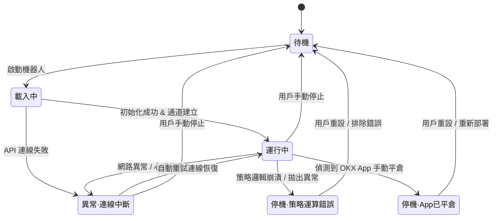

# catOS 領域術語與概念模型 (CONTEXT.md)

本文檔為 catOS 專案的通用語言（Ubiquitous Language）與領域模型唯一定義。所有代碼變數、API 欄位、UI 文案、日誌記錄與對話溝通均必須嚴格遵守本定義，嚴禁自創工程黑話。

---

## 一、交易與交易所領域詞彙 (OKX Standard Alignment)

本專案完全對齊 **OKX 官方 App** 與開源量化標準（CCXT / TradingView / Jesse）：

| 標準術語 (繁體中文) | 英文代碼 / 欄位標準 | 嚴格定義與說明 | 禁忌黑話 (嚴禁使用) |
| :--- | :--- | :--- | :--- |
| **模擬盤** | `simulated_trading` / `demo` | OKX 官方模擬交易環境，HTTP 請求強制帶 `x-simulated-trading: 1` 標頭。本專案第一版唯一運作通道。 | 紙上撮合、沙盒模擬、虛擬交易 |
| **永續合約** | `perpetual_swap` / `SWAP` | 無到期日、透過資金費率錨定現貨價值的衍生品合約（如 `BTC-USDT-SWAP`）。 | 期貨、期約、合約代幣 |
| **交易對 / 合約代碼** | `instId` / `symbol` | OKX 產品代碼，永續合約格式為 `標的資產-結算資產-SWAP`（例：`BTC-USDT-SWAP`）。 | 幣種對、交易標的、商品 |
| **標記價** | `mark_price` (`markPx`) | OKX 依據多家現貨交易所指數價格及資金費率計算出的公允基準價，用於計算未實現盈虧與強平觸發。 | 指數價、中間價、公允市價 |
| **最新成交價** | `last_price` (`lastPx`) | 市場上最新一筆撮合成交的價格。 | 市價現價、最新價 |
| **名義價值** | `notional_usd` / `notional_usdt` | 部位或委託的實質總價值（折合 USDT）。計算公式：`張數 * 合約面值 * 當前價格`。 | 總金額、持倉總額、合約額 |
| **合約張數** | `sz` (`cont`) | OKX 撮合引擎的最小下單單位。例如 BTC-USDT-SWAP 每張面值為 0.01 BTC。 | 口數、手數、數量單位 |
| **合約面值** | `ctVal` | 每張合約所代表的標的資產或結算資產數量。 | 每張價值、單張份額 |
| **逐倉保證金** | `isolated_margin` | 僅將分配給該倉位的保證金作為最大虧損上限，部位間風險隔離。本專案預設模式。 | 獨立保證金、分倉保證金 |
| **逐倉槓桿** | `leverage` | 交易所開倉時設定的名目放大倍數（如 5x, 10x）。 | 倍率、槓桿倍數 |
| **實質槓桿** | `actual_leverage` / `effective_leverage` | 全帳戶持倉名義價值總和 / 帳戶總權益。本專案風控核心，設有硬上限防爆倉。 | 真實槓桿、有效倍率、總部位槓桿 |
| **帳戶總權益** | `total_equity` | 帳戶本金加上當前所有持倉的未實現盈虧。 | 淨值、總資產、戶頭餘額 |
| **條件單** | `conditional_order` / `algo_order` | 預設觸發條件（如標記價達到特定門檻）時，才啟動的委託單。 | 觸發單、預約單 |
| **標記價條件停損** | `mark_price_stop_loss` | 委託開倉成功後，在 OKX 交易所掛出以「標記價觸發市價平倉」的條件委託單。防範滑點惡意穿價。 | 本機停損、軟止損、停損掛單 |
| **開多 / 開空** | `open_long` / `open_short` | 建立多頭（買入看漲）或空頭（賣出看跌）部位。 | 買進、做多、放空、沽空 |
| **平多 / 平空** | `close_long` / `close_short` | 結束多頭或空頭部位。 | 賣出平倉、多頭結算 |
| **全平 / 市價全平** | `close_all_market` | 一鍵以市價平掉帳戶或特定交易對的所有持倉，並撤銷所有掛單。 | 一鍵清倉、強制斷頭、大逃亡 |

---

## 二、機器人生命週期標準狀態 (Bot Lifecycle States)

狀態機嚴格限定以下 6 種合法狀態，狀態轉換必須維持排他性與單向防呆：

1. **待機 (`STANDBY`)**：機器人未運行，參數已配置或空白，尚未監聽行情或下單。
2. **載入中 (`LOADING`)**：正在載入策略插件、檢驗 API 金鑰、校準合約面值與查詢持倉。
3. **運行中 (`RUNNING`)**：連線正常，K 線與行情持續接收中，策略正常運算，具備下單權限。
4. **異常 · 連線中斷 (`ERROR_DISCONNECTED`)**：OKX API 連線超時或網路中斷，進入指數退避重連，期間暫停開倉。
5. **停機 · 策略運算錯誤 (`STOPPED_STRATEGY_ERROR`)**：策略代碼出現未捕獲異常或前視資料錯誤，系統自動熔斷停機，保留當前持倉並發出警報。
6. **停機 · App 已平倉 (`STOPPED_APP_MANUAL_CLOSED`)**：交易者在手機 OKX App 手動平倉，本機狀態機偵測到部位歸零，自動鎖定停機，**嚴禁二次反向開倉**。

---

## 三、架構 Seams 與邊界 (Architectural Seams)

1. **安全與憑證邊界 (`Security Seam`)**：
   - 負責本機 API 金鑰的 AES-256-GCM 加解密與 SQLite 本地持久化。
   - 明文金鑰僅於執行請求時於記憶體中解密並計算 HMAC 簽名，絕不出現在日誌、回傳 API 或前端。
2. **交易所通訊邊界 (`Exchange Client Seam`)**：
   - 負責所有 OKX V5 REST / WebSocket 通訊。
   - 所有 HTTP 請求強制包含 `x-simulated-trading: 1` 標頭。
   - 負責合約張數轉換與交易所端標記價條件單發送。
3. **風控閘門邊界 (`Risk Gate Seam`)**：
   - 位於「策略產生交易信號」與「向交易所送出委託」之間。
   - 實質槓桿超出硬上限時，原子化拒絕開倉請求（平倉與停損單一律放行不受限）。
4. **狀態機邊界 (`State Machine Seam`)**：
   - 維護機器人實例生命週期與同一合約排他性鎖（Single-instance Mutex per Contract）。
   - 與交易所持倉對帳，偵測 App 手動平倉行為。
