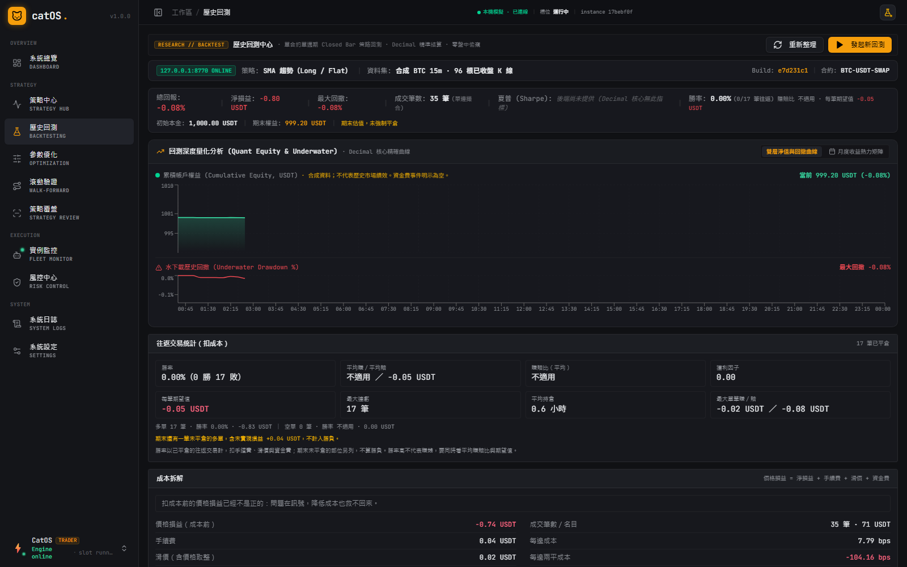
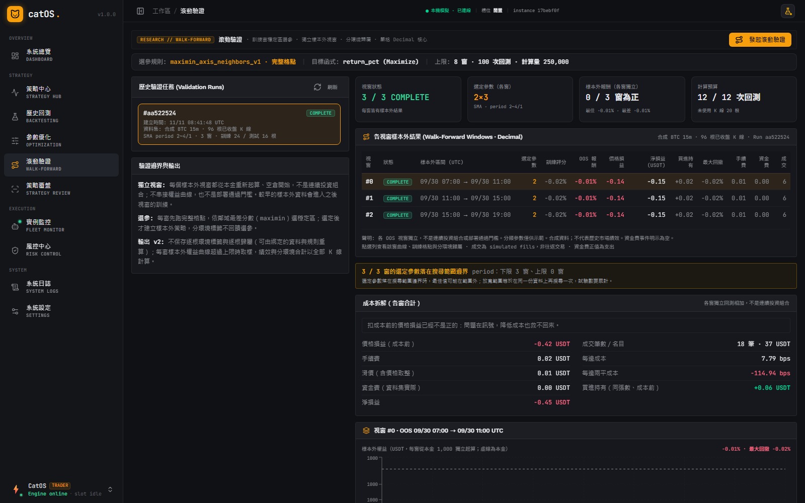

# CatOS

給用 AI Agent（Claude Code、Codex 等）輔助開發策略的量化交易者：在自己電腦上把交易想法做成策略，用回測與滾動驗證檢查它扣掉成本後還剩多少，再放進受風控約束的模擬執行裡跑。全程只連 `127.0.0.1`。



目前能做的：

- **研究**：已收盤 K 線的 Decimal 回測、參數優化與滾動驗證（walk-forward）。結果都附成本拆解、買進持有基準與過擬合檢查（DSR、PSR、PBO）。
- **Agent 介面**：研究功能有 stdio MCP（`catos.research_mcp`），Agent 可以查策略目錄、送回測與優化、讀結果與報告。
- **模擬執行**：Supervisor／Worker／風控／帳本在本機假交易所跑完整的「策略 → 意圖 → 風控 → 成交 → 帳務」流程。行情是固定的合成 K 線，用途是驗證這條管線，不是紙上交易。

還不能做的：接 OKX 模擬盤或實盤下單、同時跑多個策略或多個合約、在介面上寫或上傳策略。見「[v1 不包含](#v1-不包含)」。

## 快速開始

需要 Windows、Python 3.11 以上、Node.js 18 以上（Node 只用來建置介面）。

```bash
git clone https://github.com/b40609/CatOS.git
cd CatOS
start.bat
```

第一次執行會建立 `.venv`、安裝套件、建置介面，然後開啟 `http://127.0.0.1:8770/`；之後只會啟動服務。在視窗按 Ctrl+C 停止。

開啟後可以先試：「歷史回測」頁用內建的合成資料跑一次 SMA，「滾動驗證」頁看各窗樣本外結果，「系統總覽」啟動一次模擬 Bot。



### 接上 AI Agent

CatOS 啟動後，把這個 stdio MCP 伺服器加進你的 Agent，工作目錄設為 repo 根目錄。以常見的 `mcpServers` 設定格式為例（設定檔位置依各 Agent 的文件）：

```json
{
  "mcpServers": {
    "catos-research": {
      "command": ".venv/Scripts/python.exe",
      "args": ["-B", "-m", "catos.research_mcp"]
    }
  }
}
```

工具有 `research_catalog`、`research_list_runs`、`research_submit_backtest`、`research_submit_optimization`、`research_get_run`、`research_get_result`、`research_get_report`。它只連本機 8770，和網頁介面共用同一個研究服務，同一時間只跑一個任務。

## 現況

以下只寫實際存在並經驗證的能力。v1 已於 2026-11-04 通過正式獨立驗收（`reports/v1-acceptance-20261104/acceptance.md`）。下一步與候選工作包見 `docs/next-steps.md`。

## v1 範圍

| 項目 | v1 實況 |
| --- | --- |
| 執行環境 | 僅 local-sim：`catos/fake_exchange.py` 合成撮合，固定模板 8 根＋2 根預熱的合成 15m K 線 |
| 策略 | Bot 只有一個登錄策略 `sma-trend`／`sma-parameters-v1`（SMA 長／平），由 `catos/research_artifacts/*.json` manifest 驅動：`catos/strategy_registry.py` 只接受 `approval_state == "approved"`，載入前核對 `source_files` 的 sha256，不符即拒絕，不退回預設策略。研究另有 `donchian-breakout`／`donchian-parameters-v1`（Donchian 通道突破，多／空），以及 2026-11-06 預先登錄的三個日線策略（`catos/research_daily.py`：`donchian-ensemble` Donchian 多週期集成、`tsmom-multi` 時間序列動能、`dcm-daily` DCM 日線版）、2026-11-07 預先登錄的兩個短週期策略（`catos/research_intraday.py`：`dcm-fade` DCM 假突破反轉、`dcm-pullback` DCM 突破後回踩），manifest 都在 Worker 不讀的 `catos/research_only_artifacts/`。2026-11-12 起（第 2 步）研究策略只有在使用者以 CLI 逐一核准部署設定後，才能在 local-sim Bot 上跑歷史重播；目前只有 Donchian 可核准，其餘研究策略 Bot 仍選不到。見 `docs/step2-research-to-bot.md` |
| Bot | 單一 Bot `sim-control-sma`，單合約獨佔（`BTC-USDT-SWAP`，`cross`＋`net_mode`），單槽控制面 |
| OKX | 只有 GET 唯讀證據模組（`catos/okx_readonly.py` 離線核對、`catos/okx_http.py` 單次 GET adapter）與研究資料抓取工具 `tools/fetch_okx_candles.py`（三個公開端點，加上部位檔位端點、只限 BTC-USDT-SWAP；不用金鑰）。**沒有** Demo／Live 下單、撤單或帳戶修改路徑 |
| 研究資料 | 內建 96 根合成資料集，加上經授權抓取的 OKX 公開歷史資料（已收盤 K 線、實際資金費率、合約規格），存在本機 `data/okx/`（git 忽略）。研究端只接受 manifest 雜湊相符、無缺口的資料集，不符即拒絕；資金費必須連續到最後一根，可以晚於第一根開始（OKX 只保留約 3 個月），這時結果會明示之前未計資金費，並另列固定費率的假設情境。回測、優化與滾動驗證都有成本拆解（價格損益、手續費、滑價、資金費、每邊兩平成本）與買進持有基準（`catos/research_costs.py`）。回測、優化與滾動驗證都可選上述七個研究策略與資料集；回測另有往返交易統計（勝率、賺賠比、獲利因子、期望值，`catos/research_trades.py`）；單次回測上限 60,000 根，報告的權益圖抽樣、成交明細最多列 400 筆（完整的在 result.json）；OKX 資料集在本機有部位檔位快照時預設套用單合約全倉的保證金與強平模型（每根 K 線以最不利價檢查，強平後權益歸 0、停止交易；擴大部位時檢查初始保證金，不足拒單），結果標示是否啟用與檔位 sha256，見 `docs/research-margin-model.md`；合成資料集與沒有檔位快照時不套用並寫明原因；被強平或權益跌破 0 的執行標成爆倉，不算 Sharpe 等比率統計；優化結果附過擬合檢查（DSR、PSR、PBO，`catos/research_overfit.py`），滾動驗證附邊界選參統計，研究優化在格點點數 ≤ n_trials 時窮舉；滾動驗證結果 v2 不保存逐根明細，在 8,640 根上約 0.6 MB。見 `docs/research-real-data-plan.md` |
| 風控 | R1 台北日固定基準、Soft／Hard 日損鎖存（預設 10%／20%）、有效槓桿與單幣曝險預算（3.0x／50%）、P6 災難停損設定；`risk.Snapshot` 的事實旗標預設 fail-closed（未宣告即視為未知） |
| HTTP | 研究 API 與 local-sim 控制面投影（見下方）；**沒有** Kill-Switch／re-arm HTTP，前端對應按鈕標示「未接線」 |
| 前端 | 戰情台、實例監控、風控中心、策略中心、系統日誌與側欄狀態列讀取控制面真資料；回測／優化／滾動驗證頁接研究 HTTP；設定頁讀取服務版本；策略覆盤頁標示「v1 未啟用」。建置後由後端在 8770 直接提供 |

## 平台與環境需求

- **作業系統**：目前只在 Windows 驗證。`catos/account_lock.py` 的 `AccountLock.acquire()` 在非 `win32` 直接 `RuntimeError`（使用 `msvcrt` 檔案鎖），因此 local-sim 在 macOS／Linux 無法啟動。
- **Python**：3.11 以上；本文件的驗證使用 `.venv`（2026-11-11：Python 3.14.6；2026-11-04：3.12.10）。執行與儲存底座只有 Python 與 SQLite（WAL），不使用 Docker、PostgreSQL、Redis。
- **Node.js**：只用來建置與開發介面，執行時不需要。`frontend/cat-os-vite/package.json` 未宣告 `engines`；Vite 6 需要 Node 18 以上，本文件的驗證使用 Node 26.4.0（2026-11-04：24.19.0）。
- **換行與策略雜湊**：策略製品的 sha256 直接算在檔案位元組上，`.gitattributes` 已固定所有文字檔為 LF。Windows 使用者請設 `git config core.autocrlf false`（本 repo 已含 `.gitattributes`，兩者擇一即可）；若工作樹被轉成 CRLF，`research_catalog`／`strategy_registry` 會以 `artifact_hash_mismatch` 拒絕載入策略，測試也會失敗。

## 手動安裝與啟動

`start.bat`（呼叫 `scripts/start.ps1`）做的就是下面這些步驟；它只在 `.venv` 不存在、requirements 變更、介面未建置或原始碼比建置新時才重做，8770 被別的程式占用時不接管。

後端（repo 根目錄）：

```bash
python -m venv .venv
```

```bash
.venv/Scripts/python.exe -m pip install -r requirements-http.txt
```

`requirements-http.txt` 會一併安裝 `requirements-research.txt`（optuna、mcp、tzdata）。`tzdata` 是 Windows 上 `Asia/Taipei` 時區的必要套件。

介面（建置到 `frontend/cat-os-vite/dist`，不進版控）：

```bash
npm --prefix frontend/cat-os-vite ci
```

```bash
npm --prefix frontend/cat-os-vite run build
```

| 服務 | 埠 | 指令 |
| --- | --- | --- |
| CatOS（介面＋研究 API＋local-sim 控制面） | `127.0.0.1:8770` | `.venv/Scripts/python.exe -B -m catos.workspace_api` |
| 前端 Vite 開發伺服器（改前端時用，熱更新，代理到 8770） | `127.0.0.1:8890` | `npm --prefix frontend/cat-os-vite run dev` |
| 整合測試隔離埠 | `18870`／`18890` | 由 `tests/simulation_integration_test.mjs` 自行啟停，不碰 8770／8890 |

FastAPI 只綁定 `127.0.0.1`。介面尚未建置時，8770 的首頁會回 503 並說明怎麼建置，API 照常可用。`start-laptop-dev.bat`（呼叫 `scripts/start-laptop-dev.ps1`）是前端開發用：核對 8890 的前端身分並在未啟動時以 Vite 啟動後開瀏覽器，遇到不明 owner 不接管；該腳本本輪未執行驗證。

## 研究資料

抓取需要授權（AGENTS.md：採集不因工作包自動授權）。2026-11-04 已授權的範圍是 BTC-USDT-SWAP、15m、90 天，只呼叫三個公開端點。另一台機器要用同一份資料時，以 `--end-ms` 重抓同一區間；資料集 id 相同，`candles.csv` 與 `funding.csv` 的雜湊應一致（`instrument.json` 可能因 OKX 更新欄位而不同）：

```bash
.venv/Scripts/python.exe -B tools/fetch_okx_candles.py --inst-id BTC-USDT-SWAP --bar 15m --days 90 --end-ms 1793764800000
```

工具每次請求至少間隔 0.25 秒、單次最多 150 次請求，遇到缺口、未收盤 K 線、分頁行為不符或資金費在結束前中斷就停止，不寫入任何檔案；`--days` 上限 1,830。範圍超過單次 150 次請求時用 `--resume` 分多次接續（`--max-requests` 至少 8；進度暫存在 `data/okx/.staging/`，每次抓完 K 線就先存，最後一次才寫入資料集）。

滾動驗證（walk-forward）可直接用這份資料：前端「滾動驗證」頁（`#/validation`）或 POST `/api/research/validations`。結果 schema 是 `catos.research.validation-result.v2`：逐根環境標籤改為各環境的 K 線數，逐根歸屬只留各環境彙總，各窗樣本外權益曲線超過上限時取樣，`data/okx` 的檔案在來源快照裡只記路徑與 sha256；績效與分環境合計仍以全部 K 線計算。送出時另檢查計算量 `windows × (候選數 × (warmup + train) + warmup + test) <= 250,000`，環境分類的回看根數上限 512，避免超過 30 秒逾時。本機以研究服務實測（6 窗、4 個候選、train 2000／test 1000）：4.35 秒，result.json 599,573 bytes（上一個工作包量測；之後來源快照內嵌的引擎原始碼變大，同一請求的 result.json 會略大，結果本體相同）。欄位見 `docs/research-validation-api.md`，方案比較與更多量測見 `docs/research-real-data-plan.md`。

第二個策略 Donchian 通道突破（`donchian-breakout`，2026-11-04 使用者選定）：收盤突破前 `entry_bars` 根的最高價做多、跌破最低價做空，收盤跌破／突破前 `exit_bars` 根的反向極值就平倉。`entry_bars` 2～960、`exit_bars` 1～959 且須小於 `entry_bars`，預熱至少涵蓋最高的 `entry_bars`。三個研究頁的送出對話框都可選策略。研究服務實測 12 格點（entry 96~384/96 × exit 24~72/24）、train 2000／test 1000／6 窗：4.85 秒，result.json 556,397 bytes。和 SMA 同計畫比較，成交從 582 筆降到 55 筆、淨損從 338.51 降到 58.52 USDT，但扣成本前的價格損益仍為負，6 窗 2 窗為正。比較與量測見 `docs/research-real-data-plan.md` 的「第二個策略」。

## 測試

以下每條指令都實際執行過（2026-11-11，除非另外註明）。

後端完整套件（約 2 分鐘；2026-11-12 刪除 Virtual Lots 原型並合併日損觸發次數後的結果 902 tests、0 FAIL、0 ERROR、11 skipped：v2 候選的 python_strategy 兩個模組）：

```bash
.venv/Scripts/python.exe -m unittest discover -s tests -p "test_*.py"
```

後端示範回測（純標準函式庫，印出合成 SMA 回測 JSON）：

```bash
.venv/Scripts/python.exe -B -m examples.closed_bar_demo
```

前端型別檢查、單元測試與建置：

```bash
npm --prefix frontend/cat-os-vite run typecheck
```

```bash
npm --prefix frontend/cat-os-vite test
```

```bash
npm --prefix frontend/cat-os-vite run build
```

端到端整合測試（以 `.venv` 的 Python 在 18870 起真實 local-sim 後端、18890 起 Vite proxy，用 headless Chrome 讀戰情台、實例監控、風控中心、系統日誌、策略中心與策略覆盤頁，驗證 Decimal 字串、無 NaN 與無展示假值；最後經代理送出一次合成資料的 SMA 滾動驗證、一次 Donchian 回測與一次 Donchian 滾動驗證，讀回測頁與滾動驗證頁核對參數、報酬與各窗淨損益；共 12 項）：

```bash
node frontend/cat-os-vite/tests/simulation_integration_test.mjs
```

需要本機可用的 Chrome／Edge headless 與已建好的 `.venv`。Chrome 156（本機 156.0.8078.80 實測）的 `--dump-dom` 輸出空白，請用 `npx playwright install --only-shell chromium` 安裝 Playwright 的 `chrome-headless-shell`；測試會自動找 `%LOCALAPPDATA%\ms-playwright` 下的版本，也可用環境變數 `CATOS_CHROME` 指定路徑；截圖預設寫到系統暫存目錄的 `catos-screens`，可用 `CATOS_SCREENS` 覆寫。`frontend/cat-os-vite/tests/integration_baseline_test.mjs` 需要 playwright（未納入依賴），本輪未執行。

## 架構

```text
瀏覽器（React 19 介面）        AI Agent（stdio MCP：catos/research_mcp.py）
   │  GET /api/workspace/simulation/{state,strategies,bots,bots/{id},risk,positions,events}
   │  POST /api/workspace/simulation/{bots/start,runs/{run_id}/stop}
   │  研究 HTTP /api/research/*
   ▼
FastAPI (127.0.0.1:8770)  catos/workspace_api.py
   ├─ 介面靜態檔  frontend/cat-os-vite/dist（Vite 建置；開發時改用 8890 的 Vite 代理）
   ├─ local-sim 控制面  catos/local_sim_control*.py（單槽、request_id 冪等、state_version／domains）
   │     └─ runner → LocalSupervisor（catos/supervisor.py）
   │            ├─ Worker 子程序：catos/worker.py，JSON IPC（catos/ipc.py），只回純資料意圖
   │            │     └─ 策略由 catos/strategy_registry.py 依 manifest 驗證雜湊後載入
   │            ├─ 風控：catos/risk.py（R1 日基準、Soft／Hard 鎖存、曝險預算）、catos/protection.py（P6）
   │            ├─ 執行：catos/execution.py → catos/fake_exchange.py（v1 唯一交易所）
   │            └─ 帳本：catos/journal.py，SQLite WAL，schema 7，所有金額為 Decimal 字串（TEXT）
   └─ 研究：catos/research*.py（Closed Bar Decimal 回測、Optuna、OOS 驗證）
```

不變量：所有金額、價格、部位以 `Decimal`／SQLite `TEXT` 處理，禁止 float；Supervisor 獨佔交易出口、風控與寫庫，Worker 不持憑證、不連網；風控鎖存只能人工解除。完整規則見 `AGENTS.md`。

## v1 不包含

- `catos/python_strategy.py`／`strategy_library.py` 的上傳製品與 allocate 控制面（v2 候選；對應測試已 `unittest.skip`，見 `docs/simulation-api-contract-draft.md` Q1）。
- OKX Demo／Live 下單、撤單、帳戶修改與憑證載入；前端 demo／live 模式只回「未開放」。
- 市場情報（Yaozi）：2026-11-11 拆成獨立專案，程式、測試與文件都不在本 repo；之後以獨立服務的方式接回來，不共用程式碼。
- 策略覆盤：需要 Demo／實盤的成交與權益歷史；前端「策略覆盤」頁標示「v1 未啟用」，不顯示任何示範數字。
- 多 Bot、多合約、Kill-Switch／re-arm HTTP、P6 交易所端實際掛單。

## 文件索引

- `AGENTS.md`：專案規則、不變量、授權邊界與工作流程。
- `docs/simulation-api-contract-draft.md`：local-sim 控制面投影 HTTP 契約與第 3／4 步、v1.1 實作紀錄。
- `docs/next-steps.md`：v1 之後的候選工作包、建議順序與收尾雜項。
- `docs/research-real-data-plan.md`：研究線（真實歷史 K 線）方案、採集授權範圍與實作紀錄。
- `docs/research-validation-api.md`：滾動驗證任務的請求、限制與結果欄位（v2）。
- API 參考：服務啟動後開 `http://127.0.0.1:8770/docs`（FastAPI 依現行路由自動產生）。
- `docs/backend-frontend-integration-map.md`：研究與模擬 API 的請求範例與欄位對照（2026-10-25 的交接文件，狀態敘述已過時，範例仍可用）。
- `docs/worker.md`：Worker／IPC 契約與策略登錄。
- `docs/step2-research-to-bot.md`：研究策略核准、Bot 歷史重播與一致性比對（第 2 步）；設計與決策見 `docs/step2-research-to-bot-proposal.md`。
- `docs/archive/`：落後 v1 實作的歷史文件（架構評估、交接）。
- 開發過程的交接、評估與逐輪驗收紀錄不在 `main`，保留在 `archive/dev-history` 分支。

## 授權

MIT License，見 `LICENSE`。本專案僅供研究與本機模擬，不構成投資建議，使用風險自負。
