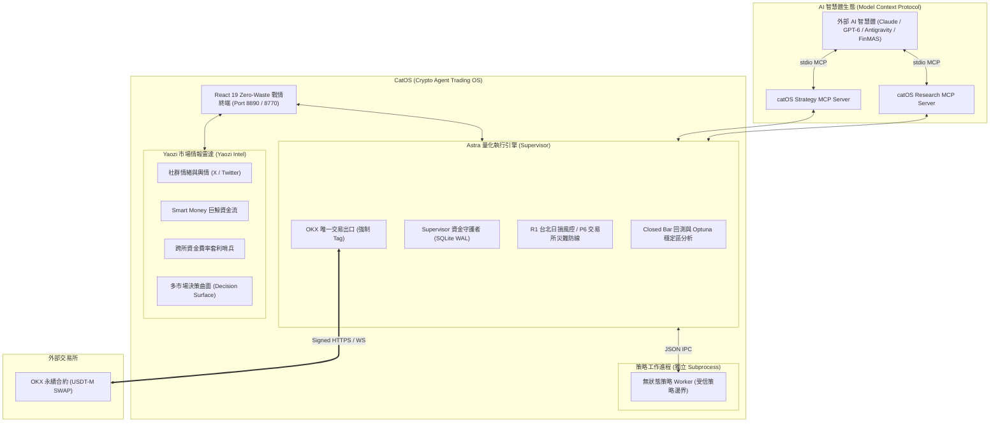

# CatOS (Crypto Agent Trading OS)

> **專為 AI 智慧體與量化交易員打造的極簡、本機專用（Localhost-Only）量化作業系統與戰情終端**  
> 融合 **原生 Model Context Protocol (MCP) 智慧體生態**、**Astra 核心量化執行引擎** 與 **Yaozi 市場情報雷達**，專為 OKX 永續合約（USDT-M SWAP）與已收盤 K 線（Closed Bar）策略量身打造。具備全鏈路零浮點誤差（Strict Decimal Core）、雙進程安全隔離與自主交易金融物理護欄。

[](https://www.python.org/)
[](catos/research_mcp.py)
[](frontend/cat-os-vite)
[-success.svg)](catos/db)
[-orange.svg)](catos/core)
[](LICENSE)

---

## 為什麼選擇 CatOS？四大核心賣點

CatOS 不是傳統封閉的手動下單軟體，而是一套**以 AI 智慧體為第一公民（Agent-First）的量化交易作業系統**，專門解決自主 AI 量化研發與資金執行的核心痛點：

### 1. 原生 MCP (Model Context Protocol) 智慧體生態
- **大模型即量化研發大腦**：原生內建標準 MCP 伺服器，直接與 Claude Code、GPT-6、Cursor、Antigravity 或自建 Multi-Agent 系統（如 FinMAS）對接。
- **工具化開放能力**：LLM 可直接調用 MCP 工具發起回測、調優參數、評估分環境表現、讀取不可變策略製品與對帳證據，實現真正的自主量化工作流。

### 2. 「靈感到不可變製品」的全自動研發閉環 (Idea-to-Execution)
- 交易員只需提供一段 TradingView / Pine Script 指標、YouTube 交易靈感或市場假說，AI Agent 即可透過 MCP 完成：
  1. **策略代碼合成 (Strategy Synthesis)**：將指標轉化為嚴格遵循受信契約的 Python 無狀態策略。
  2. **高精度閉盤回測 (Closed Bar Backtesting)**：驗證指標預熱（`warmup_bars`）、滑價與資金費結算。
  3. **參數鄰域穩定區檢驗 (Neighborhood Stability)**：利用 Optuna 搜尋具有連續穩定島嶼的參數區間，杜絕過擬合。
  4. **市場環境切片覆盤 (Market Regimes)**：分析在牛市趨勢、橫盤震盪與劇烈波動下的盈虧歸屬。
  5. **不可變製品簽名 (Immutable Artifact)**：生成具備唯一 SHA256 指紋的策略製品，安全註冊進策略倉庫。

### 3. AI 自主交易的物理級金融護欄 (Financial Hardwall for AI Agents)
- **徹底解決 AI 交易幻覺失控**：傳統 AI 交易常因幻覺產生頻繁反覆下單、手動覆寫參數或穿倉風險。CatOS Supervisor 充當不可被 Agent 覆寫的**金融硬護欄**：
  - **進程職責完全隔離**：AI 策略運行於無網路、無 API 金鑰的沙盒 Worker，只能回傳目標意圖（Target Intent）；Supervisor 獨佔金鑰與交易出口。
  - **R1 台北切日損益硬熔斷 (Hard Latch & Kill-Switch)**：依 Asia/Taipei 00:00 固定 E0 基準日損；一旦虧損達 Hard 門檻 (-20%) 立即強制市價清倉並硬鎖存，AI 智慧體無法自行解鎖，僅限人類在戰情室核驗後手動 re-arm。
  - **P6 交易所原生託管整倉災難停損**：OKX 伺服器原生條件單託管，向上/向下取整確保提前觸發；即使本地主機斷網或 AI 崩潰，交易所端仍有最終防線。
  - **唯一強制標籤**：所有 OKX SWAP 委託強制注入 `"tag": "41cb53c54d6dABDE"`，專用子帳戶隔離。

### 4. 全鏈路 Decimal 零浮點金融保證與 Zero-Waste 戰情終端
- **全流程零浮點誤差**：金額、價格、部位、保證金、手續費與資金費，全流程強制使用 Python `Decimal` 與 SQLite `TEXT` 存儲與計算，**全面禁止 `float`**。
- **Zero-Waste 純資料密度戰情室**：React 19 + TypeScript + Vite，借鑒 Bloomberg 與 TradingView Pro，消除側邊欄、全域 Header 與卡片標題的三重冗餘，搭載 Dock as Tab 自由容器與 HUD 同心圓資產曝險圖，實現極致的 Human-in-the-Loop 人機協同監控。

---

## 雙引擎智慧體生態

CatOS 採用雙主軸協同設計，所有功能集中於同一本機站點，切換分頁或關閉瀏覽器絕不影響後端交易生命週期：



---

## 原生 MCP (Model Context Protocol) 智慧體生態

CatOS 原生提供兩套基於 FastMCP 的標準 MCP 伺服器，讓外部 AI 智慧體能以標準工具調用方式深度驅動量化研究與策略生命週期：

### 1. `catos.research_mcp` (量化研究與回測 MCP)
- `research_catalog()`：查詢系統中受信註冊的策略與數據集目錄，含版本與 SHA256 來源證據。
- `research_submit_backtest(strategy, request)`：AI 自主啟動高精度 Closed Bar 回測，支援自定義標的、週期與資金費事件。
- `research_submit_optimization(strategy, request)`：AI 發起有界 Optuna 參數尋優與參數鄰域穩定區檢驗。
- `research_get_run(run_id)` / `research_get_result(run_id)`：查詢研究任務執行狀態與獲取維持 Decimal 精度的績效結果。
- `research_get_report(run_id)`：獲取單次研究任務的可視化離線 HTML 互動分析報告。

### 2. `catos.strategy_mcp` (不可變策略製品與管理 MCP)
- `strategy_contract()`：讀取系統的 Python 策略契約架構、Worker Hook 介面與受信邊界規範。
- `list_strategy_versions()`：獲取當前已固化且可重播的不可變策略製品清單及其預設參數。
- `create_strategy_version(request_id, manifest)`：AI Agent 自主生成、校驗並固化不可變 Python 策略製品，自動生成 SHA256 數位簽名，杜絕策略代碼被意外修改。
- `list_simulation_results()` / `get_simulation_result(run_id)`：審查本機模擬環境下的交易日誌、訂單序列與最終帳務對帳證據。

#### 在 Claude Desktop / Claude Code / Antigravity 中配置 CatOS MCP：
```json
{
  "mcpServers": {
    "catos-research": {
      "command": "python",
      "args": ["-B", "-m", "catos.research_mcp"]
    },
    "catos-strategy": {
      "command": "python",
      "args": ["-B", "-m", "catos.strategy_mcp"]
    }
  }
}
```

---

## 終端產品功能矩陣（十大戰情工作台）

CatOS 前端採用現代化 React 19 + TypeScript + Vite + Tailwind CSS 構建，為交易員提供十個專屬的專業工作台：

| 工作台 | 功能名稱 | 核心產品能力與交易員價值 |
|---|---|---|
| **01** | **戰情總覽 (Dashboard)** | **Zero-Waste 核心戰情室**。搭載 Dock as Tab 自由拖曳分割容器、TradingView 風格同心圓 HUD 甜甜圈資產曝險圖、即時帳戶權益帶、即時持倉盈虧與高頻成交流動態。 |
| **02** | **策略中心 (Strategy Hub)** | **智慧體策略倉庫**。支援 TradingView / Pine Script 指標轉接、策略模板管理與無狀態 Python 策略製品版本控制。 |
| **03** | **歷史回測 (Backtesting Lab)** | **高精度 Closed Bar 回測**。嚴格遵循 `warmup_bars` 預熱期指標隔離、撮合滑價與市價手續費模型、完整歷史資金費結算、交互式權益與水下拉回（Drawdown）圖表。 |
| **04** | **參數優化 (Optimization Studio)** | **Optuna 驅動超參數調優**。支援多目標搜尋、TPE 採樣、參數鄰域穩定區（Neighborhood Stability）檢驗，有效杜絕歷史過擬合陷阱。 |
| **05** | **策略覆盤 (Strategy Review)** | **分市場環境評估（Regimes）**。將歷史行情切片為趨勢、震盪、高波動等不同市場環境，驗證策略在不同環境下的損益歸屬與樣本外（OOS）滾動表現。 |
| **06** | **機器人管理 (Bot Manager)** | **執行個體生命週期控制**。實踐「One Bot, One Contract」單合約獨佔原則，提供在途訂單狀態機追蹤、一鍵啟停與緊急市價平倉（Emergency Flatten）。 |
| **07** | **風控中心 (Risk Control)** | **機構級資本守護樞紐**。即時監控 R1 台北切日損益曲線、有效槓桿倍數（Effective Leverage）、Soft/Hard 熔斷狀態機、手動 Kill-Switch 與 P6 交易所災難停損託管。 |
| **08** | **市場情報 (Market Intel - Yaozi)** | **全天候情報監控雷達**。整合 OKX 永續大額多空清算告警、跨所（OKX vs Binance）資金費率偏離套利機會、鏈上巨鯨動向與多空情緒矩陣。 |
| **09** | **系統日誌 (System Logs)** | **全鏈路審計與日誌追蹤**。即時監控 Supervisor 與 Worker 之間的 JSON IPC 封包、訂單狀態機跳轉流水與金融帳本交易重播日誌。 |
| **10** | **系統設定 (Settings)** | **環境與偏好配置**。管理 OKX 專用子帳戶 API 金鑰、配置帳戶有效槓桿上限與單幣預算占比、切換模擬與實盤環境。 |

---

## 專案結構導覽

```text
CatOS/
├── catos/                     # 後端 Python 核心架構
│   ├── research_mcp.py        # 原生 Model Context Protocol (MCP) 研究伺服器
│   ├── strategy_mcp.py        # 原生 Model Context Protocol (MCP) 策略製品伺服器
│   ├── core/                  # Decimal 算術、合約規格、事件定義
│   ├── research/              # Closed Bar 回測引擎、指標庫、撮合模型
│   ├── optimization/          # Optuna 參數搜尋、鄰域穩定度、樣本外驗證
│   ├── supervisor/            # Supervisor 行程、帳本持久化、IPC 管理
│   ├── risk/                  # R1 台北日損風控、P6 災難停損、曝險預算
│   ├── execution/             # OKX SWAP 簽名器、交易出口、FakeExchange
│   └── market_*.py            # Yaozi 市場情報系統 (社交情緒、資金流、決策曲面)
├── frontend/cat-os-vite/      # React 19 + TypeScript + Vite 戰情終端
│   ├── src/
│   │   ├── pages/             # 十大核心戰情工作台頁面 (Dashboard, Bots, Risk...)
│   │   ├── components/catos/  # 終端核心組件 (Shell, WorkspaceGrid, HUD Donut)
│   │   ├── state/             # Zustand 全域狀態 (Layout, Market, Sidebar)
│   │   └── services/          # WebSocket & REST API 客戶端
│   └── package.json
├── docs/                      # 深度架構白皮書、風控政策與驗收規範
│   ├── catOS-architecture-review.md     # 核心架構白皮書
│   ├── catos-yaozi-integration.md       # Astra / Yaozi 雙引擎整合契約
│   ├── retail-v1-simplification-*.md    # R1 風控政策定義
│   └── disaster-stop-policy.md          # P6 災難停損規範
├── examples/                  # 回測示範、合成資料與 Optuna 範例
└── tests/                     # 300+ 項高覆蓋率自動化單元與整合測試
```

---

## 快速啟動指南

### 環境需求
- **Python**：3.11 或以上（支援 `sqlite3` WAL 模式）
- **Node.js**：18.0 或以上（前端工作台構建）

### 1. 啟動前端專業戰情工作台

```bash
# 進入前端目錄
cd frontend/cat-os-vite

# 安裝依賴
npm install

# 啟動 Vite 開發伺服器（監聽 http://127.0.0.1:8890）
npm run dev
```

在瀏覽器造訪 `http://127.0.0.1:8890`，即可體驗 Zero-Waste 純資料密度戰情操作台。

### 2. 啟動後端量化與情報工作台 API

```bash
# 在專案根目錄啟動後端控制面 API (監聽 127.0.0.1:8770)
python -B -m catos.workspace_api
```

### 3. 啟動 MCP 智慧體伺服器（供 Claude / Agent 連接）

```bash
# 啟動研究與回測 MCP Server
python -B -m catos.research_mcp

# 啟動策略製品管理 MCP Server
python -B -m catos.strategy_mcp
```

### 4. 執行策略回測與報告生成

```bash
# 執行合成 15 分鐘 K 線 SMA 策略回測
python -B -m examples.closed_bar_demo

# 生成離線 HTML 互動回測報告
python -B -m examples.report_demo
```

### 5. 執行 Optuna 參數調優

```bash
# 執行多目標超參數搜尋與穩定區分析
python -B -m examples.optuna_demo
```

### 6. 執行自動化測試套件

CatOS 擁有超過 300+ 項高覆蓋率的自動化單元與整合測試，覆蓋 Decimal 算術、訂單狀態機、風控熔斷、對帳大閘與 IPC 序列化：

```bash
# 執行全量測試
python -B -m unittest discover -s tests -v
```

---

## 安全邊界與合規保證

1. **無真實金鑰洩漏**：開源代碼庫中僅包含假資料（Synthetic Fixture）與 Mock 實作，不包含任何真實 OKX API 金鑰或環境變數。
2. **受信策略邊界**：Worker 進程預設僅授予計算純訊號之權限，不提供 OS 任意命令或外部 URL 連線代理。
3. **單向資料流**：所有對外交易請求皆必須經過 Supervisor 風控檢查閘門，杜絕任何繞過風控的事後交易。

---

## 授權條款

本專案採用 [MIT License](LICENSE) 授權開源。

