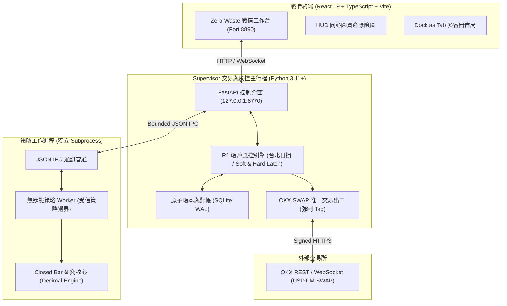

# CatOS (Quantitative Trading Operating System)

> **極簡、本機專用（Localhost-Only）的高精度量化交易作業系統與專業執行終端**  
> 專為 OKX 永續合約（USDT-M SWAP）與已收盤 K 線（Closed Bar）策略設計，具備全鏈路零浮點誤差（Strict Decimal Core）、嚴格進程安全隔離與機構級風控防線。

[](https://www.python.org/)
[](frontend/cat-os-vite)
[-success.svg)](catos/db)
[-orange.svg)](catos/core)
[](LICENSE)

---

## 專案定位與核心理念

**CatOS**（全名 **Quantitative Trading Operating System**，貓式極簡量化交易作業系統）旨在為專業量化交易員與個人自營交易（Prop Trading）打造一個**極低運維負擔、極高金融確定性**的單機量化交易與策略研究環境。

系統徹底摒棄了微服務架構在個人本機環境帶來的肥大與脆弱性（**禁止 Docker、禁止 PostgreSQL、禁止 Redis**），僅依賴 **Python 3.11+**、**SQLite（WAL 模式）** 與現代化 **React 19 / TypeScript** 戰情前端。

### 核心設計原則

1. **零浮點金融保證（Zero-Float Financial Guarantee）**：
   - 金額、價格、部位、保證金、手續費與資金費，全流程強制使用 Python `Decimal` 與 SQLite `TEXT` 存儲與計算，**全面禁止 `float`**，杜絕 IEEE 754 精度漂移與對帳分毫不差。
2. **零浪費純資料密度戰情前端（Zero-Waste Terminal Layout）**：
   - 借鑒 Bloomberg、TradingView Pro 與現代專業 IDE 的資訊架構，全螢幕無多餘留白。徹底杜絕側邊欄、全域 Header 與卡片標題的三重冗餘（Triple Redundancy），首創「Activity Bar 頂部合一微型工具列」與「Dock as Tab」多容器自由分割架構。
3. **Supervisor / Worker 進程安全邊界（Process Boundary & Non-Stateful Strategy）**：
   - **Supervisor**：獨佔 API 金鑰、外部網路連線、OKX 交易唯一出口、風控硬熔斷與 SQLite 唯一寫入權限。
   - **Worker**：運行策略演算法，僅透過標準 JSON IPC 接收已收盤行情並回傳目標意圖（Target Intent），無網路權限、無 API 憑證、無資料庫寫入權，杜絕策略程式越權。
4. **嚴苛金融級風控防線（Institutional Risk Safeguards）**：
   - **R1 每日固定風控期間基準（Fixed Risk Period Benchmark）**：依 Asia/Taipei 00:00 切日建立固定 E0 權益基準，嚴格鎖存 Soft 止增倉 / Hard 清倉鎖存（Latch）與手動 Kill-Switch，反彈或入金絕不自動解除。
   - **P6 交易所端整倉災難停損防線**：OKX 伺服器原生條件單託管，向上/向下取整（Ceil/Floor）以確保提早觸發，防範斷網與主機停機最後防線。
   - **專屬訂單標籤（Mandatory Tag）**：所有 OKX SWAP 委託強制注入 `"tag": "41cb53c54d6dABDE"`，專用子帳戶嚴禁與手動交易混用。

---

## 系統架構圖



---

## 核心功能模組

### 1. 專業級金融戰情儀表板 (Pro Terminal Frontend)
- **Zero-Waste 佈局**：活動列（Activity Bar）與頂部狀態合一，消除層層巢狀標題。
- **Dock as Tab 容器架構**：支援卡片拖曳堆疊為 Tab 頁籤、自由上下左右分割，滿足多螢幕與多面板工作流。
- **TradingView 風格資產曝險 HUD 甜甜圈圖**：
  - 同心雙環結構：內環顯示各幣種名目曝險佔比，外環顯示各合約方向（多/空）與健康度。
  - 中心即時 HUD：整合有效槓桿倍數（Effective Leverage）、風控上限與剩餘曝險預算。
- **高密度數據卡片**：即時部位損益、在途委託狀態機追蹤、R1 台北切日風控損益監控、即時日誌流。

### 2. Closed Bar 研究與回測引擎 (Research Core)
- **借鑒 Jesse API 風格之最小十進位核心**：只依賴 Python 標準庫與 `Decimal`。
- **嚴謹預熱期隔離（`warmup_bars`）**：預熱期間僅更新指標窗口，嚴格禁止產生委託意圖或計入歷史績效。
- **精確撮合模型**：本根收盤決策、下一根開盤加滑價成交（不使用訊號根收盤價偷看未來）；完整支持資金費結算時序。
- **Optuna 樣本外驗證與穩定度檢驗**：
  - 參數鄰域穩定度分析（Neighborhood Stability）。
  - 樣本外（Out-Of-Sample / OOS）滾動驗證與分市場環境（Regimes）趨勢/震盪表現評估。
  - 離線 HTML 互動回測報告生成。

### 3. 金融級帳務與虛擬批次 (Virtual Lots & Ledger)
- **S3 / S5 / S7 逐筆帳務流水**：
  - 支援單筆訂單精確歸屬 Virtual Lot、完整 USDT 手續費與成交更正重放證明。
  - 合成情境離線報告與長 Decimal 精度校驗。
- **故障恢復與重啟對帳**：重啟時自動由 SQLite WAL 載入歷史狀態，嚴格防範 UNKNOWN 訂單盲目重送。

---

## 專案結構導覽

```text
CatOS/
├── catos/                     # 後端 Python 核心
│   ├── core/                  # Decimal 算術、合約規格、事件定義
│   ├── research/              # Closed Bar 回測引擎、指標庫、撮合模型
│   ├── optimization/          # Optuna 參數搜尋與格點穩定度評估
│   ├── supervisor/            # Supervisor 行程、帳本持久化、IPC 管理
│   ├── risk/                  # R1 台北日損風控、P6 災難停損、曝險預算
│   └── execution/             # OKX SWAP 簽名器、交易出口、FakeExchange
├── frontend/cat-os-vite/      # React 19 + TypeScript 戰情終端
│   ├── src/
│   │   ├── components/catos/  # 終端核心組件 (Shell, WorkspaceGrid, HUD Donut)
│   │   ├── services/          # WebSocket & REST API 客戶端
│   │   └── types/             # 全鏈路 TypeScript 定義
│   └── package.json
├── docs/                      # 架構審查、風控政策與驗收規範
│   ├── catOS-architecture-review.md     # 核心架構白皮書
│   ├── retail-v1-simplification-*.md    # R1 風控政策定義
│   ├── disaster-stop-policy.md          # P6 災難停損規範
│   └── ...
├── examples/                  # 回測示範、合成資料與 Optuna 範例
└── tests/                     # 300+ 項高覆蓋率自動化單元與整合測試
```

---

## 快速啟動指南

### 環境要求
- **Python**：3.11 或以上（需支援 `sqlite3` WAL 模式）
- **Node.js**：18.0 或以上（前端構建）

### 1. 前端戰情儀表板啟動

```bash
# 進入前端目錄
cd frontend/cat-os-vite

# 安裝依賴
npm install

# 啟動 Vite 開發伺服器（預設監聽 http://127.0.0.1:8890）
npm run dev
```

瀏覽器造訪 `http://127.0.0.1:8890`，即可體驗 Zero-Waste 專業量化戰情操作台。

### 2. 執行研究與回測範例

```bash
# 執行合成 15 分鐘 K 線 SMA 回測示範
python -B -m examples.closed_bar_demo

# 生成離線 HTML 互動回測報告
python -B -m examples.report_demo
```

### 3. 執行 Optuna 參數調優

```bash
# 執行多目標參數搜尋示範
python -B -m examples.optuna_demo
```

### 4. 執行自動化測試套件

CatOS 擁有超過 300+ 項嚴格的單元與整合測試，覆蓋 Decimal 核心算術、風控熔斷、狀態機與帳本持久化：

```bash
# 執行研究核心測試
python -B -m unittest discover -s tests -p "test_research*.py" -v

# 執行風控與帳務測試
python -B -m unittest discover -s tests -p "test_risk*.py" -v

# 執行全量測試
python -B -m unittest discover -s tests -v
```

---

## 安全邊界與合規保證

1. **無真實金鑰洩漏**：開源代碼庫中僅包含假資料（Synthetic Fixture）與 Mock 實作，不包含任何真實 OKX API 金鑰或環境變數。
2. **受信策略邊界**：系統遵循受信策略邊界設計，Worker 進程預設僅授予計算純訊號之權限，不提供 OS 任意命令或外部 URL 連線代理。
3. **單向資料流**：所有對外交易請求皆必須經過 Supervisor 風控檢查閘門，杜絕任何繞過風控的事後交易。

---

## 授權條款

本專案採用 [MIT License](LICENSE) 授權開源。

