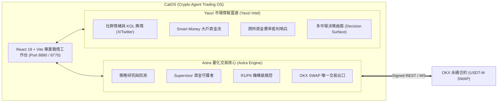

# CatOS (Crypto Agent Trading OS)

> **極簡、本機專用（Localhost-Only）的加密貨幣智慧體量化交易作業系統與專業執行終端**  
> 融合 **Astra 核心量化執行引擎** 與 **Yaozi 市場情報雷達**，專為 OKX 永續合約（USDT-M SWAP）與已收盤 K 線（Closed Bar）策略量身打造。具備全鏈路零浮點誤差（Strict Decimal Core）、雙進程安全隔離與機構級風控防線。

[](https://www.python.org/)
[](frontend/cat-os-vite)
[-success.svg)](catos/db)
[-orange.svg)](catos/core)
[](LICENSE)

---

## 產品定位與核心解決方案

**CatOS**（全名 **Crypto Agent Trading OS**，加密貨幣智慧體量化交易作業系統）專為專業量化交易員、KOL 與自營交易團隊（Prop Trading）設計，旨在提供一個**極低維護負擔、極高金融確定性**的單機智慧體量化研發與實盤交易戰情室。

### 解決傳統量化系統的痛點
1. **擺脫過度設計的微服務負擔**：全面禁止 Docker、PostgreSQL、Redis、Celery 等外部常駐服務，僅依賴 **Python 3.11+** 與 **SQLite（WAL 模式）**，雙擊即可啟動，單機擁有完整故障自愈與對帳能力。
2. **杜絕浮點數資金精度漂移**：傳統量化框架（如 Jesse、Freqtrade）底層大量混用 NumPy/Float，造成不可逆的捨入誤差；CatOS 全流程堅持 **Strict Decimal Core**，價格、數量、手續費與未實現損益零浮點漂移。
3. **消除終端介面的三重標題浪費**：借鑒 Bloomberg 與 TradingView Pro，開創「Zero-Waste 純資料密度」戰情佈局，徹底消除側邊欄、全域 Header 與卡片標題的三重冗餘（Triple Redundancy）。

---

## 雙引擎智慧體生態

CatOS 採用雙主軸協同設計，所有功能集中於同一本機站點，切換分頁或關閉瀏覽器絕不影響後端交易生命週期：



- **Astra 核心量化引擎**：負責分鐘至小時級已收盤 K 線策略回測、參數優化、多市場環境評估、Supervisor-Worker 雙進程隔離執行，以及單合約獨佔的訂單生命週期管理。
- **Yaozi 市場情報雷達**：負責整合多源外部情報——包含 X (Twitter) 社群輿情指數、OKX/Binance 資金費率偏離套利監控、巨鯨大額轉移警報與決策曲面（Decision Surface），為策略決策提供情報加權。

---

## 終端產品功能矩陣（十大戰情工作台）

CatOS 前端採用現代化 React 19 + TypeScript + Vite + Tailwind CSS 構建，為交易員提供十個專屬的專業工作台：

| 工作台 | 功能名稱 | 核心產品能力與交易員價值 |
|---|---|---|
| **01** | **戰情總覽 (Dashboard)** | **Zero-Waste 核心戰情室**。搭載 Dock as Tab 自由拖曳分割容器、TradingView 風格同心圓 HUD 甜甜圈資產曝險圖、即時帳戶權益帶、即時持倉盈虧與高頻成交流動態。 |
| **02** | **策略中心 (Strategy Hub)** | **智慧體策略倉庫**。支援 TradingView / Pine Script 指標轉接、策略模板管理與無狀態 Python 策略製品版本控制。 |
| **03** | **歷史回測 (Backtesting Lab)** | **高精度 Closed Bar 回測**。嚴格遵循 `warmup_bars` 預熱期指標隔離、撮合滑價與市價手續費模型、完整歷史資金費結算、交互式權益與水下拉回（Drawdown）圖表。 |
| **04** | **參數優化 (Optimization Studio)** | **Optuna 驅動超參數調優**。支援多目標搜尋、TPE 採樣、參數鄰域穩定區（Neighborhood Stability）檢驗，有效杜絕歷史過擬合陷阱。 |
| **05** | **策略覆盤 (Strategy Review)** | **分市場環境評估（Regimes）**。將歷史行情切片為趨勢、震盪、高波動等不同市場環境，驗證策略在不同環境下的損益歸屬與樣本外（OOS）滾動表現。 |
| **06** | **機器人管理 (Bot Manager)** | **執行個體生命週期控制**。實踐「One Bot, One Contract」單合約獨佔原則，提供在途訂單狀態機追蹤、一鍵啟停與緊急市價平倉（Emergency Flatten）。 |
| **07** | **風控中心 (Risk Control)** | **機構級資本守護樞紐**。即時監控 R1 台北切日損益曲線、有效槓桿倍數（Effective Leverage）、Soft/Hard 熔斷狀態機、手動 Kill-Switch 與 P6 交易所災難停損託管。 |
| **08** | **市場情報 (Market Intel - Yaozi)** | **全天候情報監控雷達**。整合 OKX 永續大額多空清算告警、跨所（OKX vs Binance）資金費率偏離套利機會、鏈上巨鯨動向與多空情緒矩陣。 |
| **09** | **系統日誌 (System Logs)** | **全鏈路審計與日誌追蹤**。即時監控 Supervisor 與 Worker 之間的 JSON IPC 封包、訂單狀態機跳轉流水與金融帳本交易重播日誌。 |
| **10** | **系統設定 (Settings)** | **環境與偏好配置**。管理 OKX 專用子帳戶 API 金鑰、配置帳戶有效槓桿上限與單幣預算占比、切換模擬與實盤環境。 |

---

## 核心技術與金融安全防線

### 1. 全鏈路零浮點保證（Zero-Float Financial Core）
- 所有金額、價格、部位、保證金、手續費與資金費，全流程強制使用 Python `Decimal` 與 SQLite `TEXT` 存儲與計算。
- **全面禁止 `float`** 計算，避免 IEEE 754 精度漂移導致的對帳不平或錯誤平倉。

### 2. Supervisor / Worker 進程安全隔離
- **Supervisor（主行程）**：獨佔 API 憑證、外部連網、OKX 唯一交易出口、風控狀態機與 SQLite WAL 唯一寫入權限。
- **Worker（策略子進程）**：無網路連線權限、無 API 金鑰、無資料庫寫入權，僅透過標準 JSON IPC 接收已收盤行情並回傳目標意圖（Target Intent），從架構上杜絕策略越權。

### 3. 機構級風控三重保障
- **R1 固定風控期間基準（Risk Period Benchmark）**：依 Asia/Taipei 每日 00:00 切日建立固定 E0 權益基準，精確計算日損；Soft 止增倉 (-10%) 與 Hard 清倉 (-20%) 一旦觸發立即鎖存（Latch），反彈或入金絕不自動解除，僅限人工核驗後 re-arm。
- **P6 交易所端整倉災難停損防線**：OKX 伺服器原生條件單託管，向上/向下取整（Ceil/Floor）以確保提早觸發，作為主機離線或斷網時的最後一道物理保險。
- **專用子帳戶與強制標籤**：所有 OKX SWAP 委託強制注入 `"tag": "41cb53c54d6dABDE"`，專用子帳戶嚴禁與手動交易混用。

### 4. 虛擬批次與逐筆帳務（Virtual Lots & Ledger）
- S3–S10 逐筆帳務流水支援單筆訂單精確歸屬至 Virtual Lot，具備完整 USDT 手續費核算與成交更正重放證明（Correction Replay Proof）。

---

## 專案結構導覽

```text
CatOS/
├── catos/                     # 後端 Python 核心架構
│   ├── core/                  # Decimal 算術、合約規格、事件定義
│   ├── research/              # Closed Bar 回測引擎、指標庫、撮合模型
│   ├── optimization/          # Optuna 參數搜尋、鄰域穩定度、樣本外驗證
│   ├── supervisor/            # Supervisor 行程、帳本持久化、IPC 管理
│   ├── risk/                  # R1 台北日損風控、P6 災難停損、曝險預算
│   ├── execution/             # OKX SWAP 簽名器、交易出口、FakeExchange
│   └── market_*.py            # Yaozi 市場情報系統 (社交情緒、資金流、決策曲面)
├── frontend/cat-os-vite/      # React 19 + TypeScript + Vite 戰情終端
│   ├── src/
│   │   ├── pages/             # 十大核心戰情工作台頁面 (Dashboard, Bots, Risk...)
│   │   ├── components/catos/  # 終端核心組件 (Shell, WorkspaceGrid, HUD Donut)
│   │   ├── state/             # Zustand 全域狀態 (Layout, Market, Sidebar)
│   │   └── services/          # WebSocket & REST API 客戶端
│   └── package.json
├── docs/                      # 深度架構白皮書、風控政策與驗收規範
│   ├── catOS-architecture-review.md     # 核心架構白皮書
│   ├── catos-yaozi-integration.md       # Astra / Yaozi 雙引擎整合契約
│   ├── retail-v1-simplification-*.md    # R1 風控政策定義
│   └── disaster-stop-policy.md          # P6 災難停損規範
├── examples/                  # 回測示範、合成資料與 Optuna 範例
└── tests/                     # 300+ 項高覆蓋率自動化單元與整合測試
```

---

## 快速啟動指南

### 環境需求
- **Python**：3.11 或以上（支援 `sqlite3` WAL 模式）
- **Node.js**：18.0 或以上（前端工作台構建）

### 1. 啟動前端專業戰情工作台

```bash
# 進入前端目錄
cd frontend/cat-os-vite

# 安裝依賴
npm install

# 啟動 Vite 開發伺服器（監聽 http://127.0.0.1:8890）
npm run dev
```

在瀏覽器造訪 `http://127.0.0.1:8890`，即可體驗 Zero-Waste 純資料密度戰情操作台。

### 2. 啟動後端量化與情報工作台 API

```bash
# 在專案根目錄啟動後端控制面 API (監聽 127.0.0.1:8770)
python -B -m catos.workspace_api
```

### 3. 執行策略回測與報告生成

```bash
# 執行合成 15 分鐘 K 線 SMA 策略回測
python -B -m examples.closed_bar_demo

# 生成離線 HTML 互動回測報告
python -B -m examples.report_demo
```

### 4. 執行 Optuna 參數調優

```bash
# 執行多目標超參數搜尋與穩定區分析
python -B -m examples.optuna_demo
```

### 5. 執行自動化測試套件

CatOS 擁有超過 300+ 項高覆蓋率的自動化單元與整合測試，覆蓋 Decimal 算術、訂單狀態機、風控熔斷、對帳大閘與 IPC 序列化：

```bash
# 執行全量測試
python -B -m unittest discover -s tests -v
```

---

## 安全邊界與合規保證

1. **無真實金鑰洩漏**：開源代碼庫中僅包含假資料（Synthetic Fixture）與 Mock 實作，不包含任何真實 OKX API 金鑰或環境變數。
2. **受信策略邊界**：Worker 進程預設僅授予計算純訊號之權限，不提供 OS 任意命令或外部 URL 連線代理。
3. **單向資料流**：所有對外交易請求皆必須經過 Supervisor 風控檢查閘門，杜絕任何繞過風控的事後交易。

---

## 授權條款

本專案採用 [MIT License](LICENSE) 授權開源。

