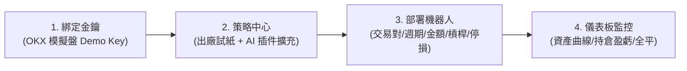

# catOS V1 核心架構規格書 (catOS_V1.md)

> **版本**：V1.1 Clean Architecture (2026 方案 A 架構定案版)  
> **專案負責人**：Kai（交易者，OKX KOL，台灣，具備軟體與 Vibe coding 基礎）。  
> **核心使命**：打造交易者專屬的 OKX 模擬盤量化控制台——透過本地 AI 輔助，將交易構想轉化為具備研究級回測嚴謹度、原生對齊 OKX 合約規則、能穩定過夜運行的量化機器人系統。

---

## 一、產品核心紅線（不得違背）

1. **唯一通道**：第一版只准連接 **OKX 模擬盤**（Demo API Key，強制帶 `x-simulated-trading: 1` 標頭），絕對不碰實盤真錢，不跑純本機紙上虛擬撮合。
2. **AI / MCP 不能下單**：AI 負責策略編寫、調參、插件安裝與回測，但**絕不下單、不動金鑰、不觸發全平**。下單與平倉權限 100% 掌握在交易者與本機狀態機手中。
3. **交易所標記價條件停損**：停損單必須掛在交易所端（OKX 標記價觸發市價平倉），不在本機記憶體軟止損，防範斷網斷電風險；留白代表不掛停損。
4. **同一交易對排他性**：同一合約（如 BTC-USDT-SWAP）同一時間只允許一台機器人處於運行中。
5. **OKX App 狀態同步**：交易者在手機 OKX App 手動平倉後，機器人自動同步轉為 `停機 · App 已平倉`，絕不二次反向開倉。
6. **語言與術語標準**：全介面使用繁體中文，嚴格對齊 OKX App 標準交易術語與業界量化標準用詞（如 CCXT、TradingView、Jesse），**嚴禁自創工程黑話**。

---

## 二、核心架構定案：【方案 A】一體化後端

本系統拒絕拼裝多進程黑盒子（如多終端機分別跑回測與下單），採用**單一進程、內嵌封裝**的專業架構：

```
catOS/
├── src/
│   ├── api/             # FastAPI 後端路由 (REST + SSE 即時事件流)
│   ├── core/            # 安全加密、風控引擎 (實質槓桿硬上限)、狀態機
│   ├── exchange/        # 原生 OKX V5 模擬盤專用連線層 (簽名、合約張數轉換、撮合、標記價條件單)
│   ├── plugins/         # 策略插件模組 (對齊 Jesse 策略規範，含 params_schema 動態表單)
│   │   └── strategies/  # 出廠雙試紙 (Signal Test、SMA 5/20) 及 AI 新增策略
│   └── web/             # 前端編譯產物 (dist)，由 FastAPI 本地託管
├── tests/               # 完整單元測試與端到端模擬測試
└── 啟動catOS.bat         # 終端用戶雙擊一鍵啟動腳本
```

### 1. 回測大腦與策略規格（對齊 Jesse 嚴謹度）
- **策略介面**：插件採用純 Python 規範，符合 Jesse 策略物件語法（`should_long`、`go_long`、`evaluate`）。
- **回測引擎規格**：未來 V2 直接內嵌 `jesse.research` 模組，杜絕傳統向量化回測的「前視偏差」與「K 線內樂觀撮合」陷阱，原生具備 8 小時資金費率結算、精確滑點與強平價模擬。
- **動態參數 Schema (`params_schema`)**：每個策略宣告其參數型別、預設值與單位，前端自動依此動態長出調節表單。

### 2. 執行與風控大腦（原生 OKX 永續合約連線層）
- 吸納 OKX 官方 `okx/agent-trade-kit` 的原廠風控精神，以純 Python 非同步實作：
  - **合約張數精確換算**：自動在 USDT 名義價值與 OKX 永續合約「張數（cont）」間精確轉換。
  - **標記價條件停損**：委託開倉成交後，原子化掛出交易所端條件停損單。
  - **實質槓桿硬上限**：即時計算全帳戶持倉名義價值總和 / 帳戶總權益，超出交易者自訂硬上限（如 2.0x、3.0x）時**強制拒絕新開倉**，絕不干涉平倉。

### 3. 前端狀態說明（目前：尚未定案，開放設計）
- **當前現況**：前端視覺風格與具體框架（Vue 3 / React）**目前保留開放，尚未定案**。
- **後端標準**：後端嚴格採用標準 REST API + SSE 事件流對外提供服務，前後端完全解耦。
- **託管原則**：前端無論後續使用何種技術工具產出，最終只需編譯為靜態 HTML/CSS/JS 放入 `src/web/`，由 FastAPI 一體化掛載託管。終端用戶雙擊 `啟動catOS.bat` 即可在瀏覽器打開，電腦**無需安裝 Node.js**。

---

## 三、用戶核心旅程（4-Step Flow）



1. **步驟 1 · 綁定金鑰**：輸入 OKX Demo API Key / Secret / Passphrase，系統即時驗證並以 AES-256-GCM 存於本機 SQLite，絕不上傳雲端。
2. **步驟 2 · 策略中心**：瀏覽出廠測試策略，或讓本地 AI 直接編寫並載入新策略插件。
3. **步驟 3 · 部署機器人**：從策略中心挑選策略 ➔ 選擇交易對（強制手選防呆）、K 線週期、下單名義價值（USDT）、逐倉槓桿、停損% ➔ 一鍵啟動。
4. **步驟 4 · 儀表板與風控**：即時掌握帳戶總權益、實質槓桿、機器人部位與盈虧走勢；突發狀況下一鍵執行「帳戶市價全平」。

---

## 四、出廠唯二測試策略（目的：檢驗通道與下單鏈路）

1. **策略一：下單通道驗證試紙 (Signal Test)**
   - 無部位時下一根收盤立即市價開多，同時掛出交易所標記價條件停損。
   - 持倉第 N 根（預設 1 根）收盤無條件市價平倉，驗證開倉、掛單、平倉全生命週期。
2. **策略二：經典均線策略 (SMA 5/20)**
   - 快線 5 上穿慢線 20 金叉開多，下穿死叉開空。
   - 等穿越、不加倉，作為趨勢策略的基準範本。

---

## 五、開發實施里程碑

- **第一階段：後端架構與插件核心 (Clean Core)**
  - 建立 `requirements.txt`。
  - 本地 AES-256-GCM 金鑰模組 (`security.py`)。
  - OKX V5 模擬盤非同步客戶端 (`okx_client.py`，含簽名、張數換算、標記價停損、指數退避)。
  - 實質槓桿硬上限風控引擎 (`risk_engine.py`)。
  - 機器人生命週期狀態機 (`state_machine.py`，含排他性防呆與 OKX App 平倉同步)。
  - 策略插件標準介面 (`base.py`)、熱加載沙盒 (`loader.py`) 與出廠雙試紙。
  - 單元測試全面通過。
- **第二階段：API 路由與 SSE 即時事件流**
  - FastAPI 路由實作 (`routes.py`) 與 SSE 事件流 (`events.py`)。
  - 驗證 API 與後端核心無縫聯調。
- **第三階段：前端定案與整合 (UI Integration)**
  - 定案前端原型與組件庫，接入後端 API。
  - 編譯靜態產物並交由 FastAPI 託管。
- **第四階段：端到端過夜驗收 (End-to-End Soak)**
  - OKX 模擬盤連續運行、條件停損觸發、手機 App 手動平倉同步驗收。
  - 封裝 `啟動catOS.bat`，交付完工成果。
