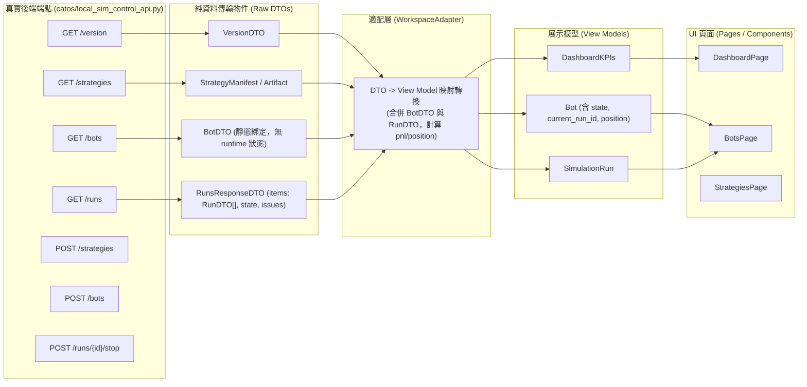

# catOS 新前端第二版 (redesign-v1 v2) 開發交接文件

- **對接角色**：本機 Codex（後端正式 API / DOM 接線與全新隔離自測）、WorkBuddy（獨立驗收與 Git 核對）
- **交付規格**：Vue 3 + TypeScript (strict) + Vite 6 + Vue Router 4 + 原生 CSS Variables（零外部字型外鏈）
- **審查基準**：依據《新前端第一版審查（2026-10-04）》（`docs/frontend-review-20261004.md`）完成 8 項 P1/P2 缺陷修復。
- **打包產出**：`frontend/redesign-v1/dist/` 靜態檔案，以相對路徑 `./` 引用，由既有 Python HTTP 伺服器直接掛載。

---

## 一、第二版核心缺陷修復清單 (P1 & P2)

| 編號 | 缺陷等級 | 審查問題點 | 第二版修復與實作細節 |
| :--- | :--- | :--- | :--- |
| **1** | **P1: Mock 命令狀態** | 命令回成功但版本庫、Bot、Run 儲存未變更，重新整理後記錄消失。 | 實作具狀態隔離儲存（Stateful Mock Storage with LocalStorage 持久化，key: `catos_mock_storage_v2`）。新增 Bot 即時入庫、啟動指派 32-char hex `run_id` 轉 RUNNING、停止依真 run_id 轉 STOPPED 並保留合約部位；瀏覽器重新整理（F5）後完整保留。 |
| **2** | **P1: 503 離線假正常** | 遙測硬編碼連線正常/PID/16ms；503 時保留舊資料，佈局 A/B 誤報 NORMAL 與「風控委託正常」。 | `useWorkspace.ts` 移除硬編碼，呼叫 `fetchTelemetry()`；`useDashboard.ts` 遇 503 即標記 `isUnavailable = true`，清除舊值，風控狀態轉為 `UNAVAILABLE`，所有數值 fallback 顯示 `—`。佈局 A/B 增加專屬 503 紅色警示橫幅，嚴格禁止未知轉零或正常。 |
| **3** | **P1: 分配快照與參數** | `allocateBot` 寫死首個策略快照與固定 15m；參數僅 flat 型別，小數誤轉 float。 | `mock-adapter.ts` 依據傳入的 `artifact_hash` 精準檢索策略製品並深度凍結快照；`src/contracts/strategy.ts` 引入 `BoundedJsonValue` 支援有界遞迴 JSON；小數維持 Decimal 字串；表單依選版動態載入完整預設參數供審閱編輯。 |
| **4** | **P1: 命令契約與重送** | Request ID 每次隨機重產；停止命令依賴虛構 `run-default`；無 pending 重送支援。 | 規範 Request ID 為 32-char hex；移除虛構 `run-default`，停止前核對 Bot 真實 `current_run_id`；支援 `PendingCommand` 結構（保留 ID、Action、Payload、Build ID、Instance ID），提供「重送原命令」機制，嚴禁直接發送新 ID 命令。 |
| **5** | **P1: DTO 與 View Model** | 交接誤將 View Model 視為後端真實 API，假設不存在的 `/api/workspace/simulation`。 | 徹底分離 Raw DTO 與 View Model： • DTO：`BotDTO`, `RunDTO`, `RunsResponseDTO`（含 `items`, `state`, `issues`）, `VersionDTO` • View Model：`Bot`（結合 run 狀態）、`SimulationRun` 由 Adapter 負責兩者轉換映射；頁面與元件僅消費 View Model，解除對具體 Mock 耦合。 |
| **6** | **P2: 檔案匯入與歷史入口** | StrategiesPage 匯入按鈕無 handler；AST 通過徽章無後端依據；缺 Run 歷史入口。 | 實作標準 `<input type="file" accept=".py,.json">`，支援讀取解析並建立新版本；徽章誠實標註為「原型語法預檢 (示意)」；BotsPage 頂部增加「檢視執行成果歷史」抽屜，可展開查看歷次不可變 Run 紀錄。 |
| **7** | **P2: 人工信任確認防護** | 對話框開啟、關閉或切換策略時殘留 `isTrusted`，存在誤授權風險。 | 對話框初始未預勾；在 Modal 開啟、關閉取消、以及下拉切換策略時，均強制重設 `isTrusted = false`；表單即時展示所選策略原始碼與參數，確保每一次分配皆由人工審核。 |
| **8** | **P2: 產品狀態與離線字型** | Demo/Live 被 disable 無法切換展示且未置於 LOGO 旁；誤留已取消的風控緩衝；外鏈 Google Fonts。 | `ModeSelector` 移至側邊欄 LOGO 旁；啟用 Demo / Live 按鈕，切換時提供醒目的頂部隔離展示警示橫幅（標明未經授權禁止交易）；移除 base.css 中的 Google Fonts 外鏈，全站採用本機安全無襯線字型；移除已取消的「風控緩衝預留」。 |

---

## 二、DTO (Raw Backend Model) 與 View Model 映射架構

為解決第一版交接混淆後端真實端點與展示模型的問題，第二版架構在 `src/contracts/` 與 `src/adapters/` 嚴格定義分層：

### 1. 後端端點真實對照表（Codex 接線依據）
- **版本與環境識別**：`GET /version` -> 回傳 `VersionDTO`（含 `version`, `build_id`, `instance_id`）。
- **策略列表**：`GET /strategies` -> 回傳 `StrategyArtifact[]`（包含 `contract: "catos.python-strategy.v1"`）。
- **策略建立**：`POST /strategies` -> Body: `{ request_id: string, manifest: StrategyManifest }`。
- **Bot 列表**：`GET /bots` -> 回傳 `BotDTO[]`（僅含靜態綁定資訊，**無 runtime 狀態**）。
- **Bot 分配**：`POST /bots` -> Body: `{ request_id: string, artifact_hash: string, parameters: BoundedJsonObject, mode: 'local_sim' }`。
- **Run 列表與狀態**：`GET /runs` -> 回傳 `RunsResponseDTO`（格式為 `{ items: RunDTO[], state: string, issues: string[] }`）。
- **單一 Run 詳情**：`GET /runs/{run_id}` -> 回傳 `RunDTO`。
- **停止 Run**：`POST /runs/{run_id}/stop` -> 需攜帶真實 `run_id`（禁止使用虛構字串），Headers 需包含 `X-CatOS-Build` 與 `X-CatOS-Instance`。

---

## 三、自動化驗證與存證結果

第二版已透過 Puppeteer Core 連接本地 Chrome，於獨立預覽服務（`http://127.0.0.1:61943/`）執行完整的端到端驗證腳本 `scripts/verify-full-suite.js`：

- **測試案例總數**：25 項
- **測試通過數量**：25 項 (100% PASS)
- **測試失敗數量**：0 項
- **瀏覽器 Console 錯誤**：0 errors, 0 warnings
- **涵蓋情境**：
  1. `MODE_SELECTOR_LOGO` & `MODE_DEMO_ISOLATION` & `MODE_LIVE_ISOLATION`：LOGO 旁切換與警告橫幅。
  2. `SET_503_SCENARIO` & `503_LAYOUT_A_BANNER` & `503_NO_FALSE_NORMAL_A`：佈局 A 離線警示、狀態嚴格 UNAVAILABLE、無任何 NORMAL 偽報。
  3. `503_LAYOUT_B_BANNER` & `503_NO_FALSE_SAFE_B`：佈局 B 離線警示、移除誤報正常、呈現 503 處理箱。
  4. `AST_BADGE_HONEST`：策略徽章誠實標註「原型語法預檢 (示意)」。
  5. `STRATEGY_IMPORT_JSON`：JSON 檔案真實上傳並解析註冊入版本庫。
  6. `ALLOCATE_TRUST_INITIAL_UNCHECKED` & `RESET_ON_REOPEN` & `RESET_ON_STRATEGY_SWITCH`：人工信任重置保護機制。
  7. `ALLOCATE_DEFAULTS_PREVIEW` & `BOT_ALLOCATE_PERSISTENCE`：動態載入預設值、成功分配並即時入列（Bot 總數由 3 增至 4）。
  8. `BOT_START_STATE_UPDATED` & `BOT_STOP_STATE_UPDATED`：啟動指派 run_id 轉 RUNNING，停止確認真實 run_id 轉 STOPPED。
  9. `COMMAND_LOGS_RECORDED` & `REFRESH_COMMAND_LOGS_PRESERVED`：命令記錄入庫，頁面重新整理（F5）後完整保留。
  10. `REFRESH_BOT_PERSISTED` & `RUNS_HISTORY_DRAWER`：重新整理後 Bot 仍在，成果歷史抽屜正常展開顯示不可變 Run 記錄。
- **測試產物記錄**：`evidence/verification_summary.json`，截圖存於 `evidence/503_layout_a_1440.png`、`503_layout_b_1440.png`、`bots_and_history_verified.png`。

---

## 四、金融正確性與資安約束（不變原則）

1. **小數與金額格式**：前端接收與顯示金額、價格、部位與費用一律維持字串（Decimal），禁止轉為 JavaScript float 進行任何加減乘除或回傳給後端。
2. **OKX SWAP 標籤固定**：所有委託標籤維持固定值 `"41cb53c54d6dABDE"`。
3. **單 Bot 獨佔**：合約持有部位時（例如 `-1` 張），即使停止亦保留獨佔；禁止新 Bot 綁定（409 衝突處理）。
4. **人工信任確認**：信任核取方塊絕不預先勾選，每次開啟對話框或切換策略時必須強制重設為未勾選。
5. **服務離線邊界**：後端回傳 503 或網路中斷時，禁止數值轉零或宣告風控安全，嚴格顯示 `UNAVAILABLE` 與中斷警示。

---

## 五、前端資訊架構定案：全面採納方案 A 頂部合一 (Zero-Waste Layout)

依據 2026-10-04 使用者明確指示：「採用方案 A：頂部合一 其他選項可以刪掉了」，前端完成架構定案與全站收斂：

1. **頂部合一架構 (Unified Topbar)**：
   - 側邊欄（標記當前路徑）+ 全域頂部 Header（左側微型標題 + 右側 Teleport 動作按鈕）一體成型。
   - 頁面內部徹底刪除 `
`（包含巨大 H2 標題與描述橫幅），釋放 65px~80px 縱向視野。
   - 儀表板、歷史回測、參數優化、機器人管理、風控中心、策略中心等所有卡片直接頂格（Top-Aligned），符合彭博專業終端、TradingView 之零浪費資料密度標準。
2. **清理範圍與過渡移除**：
   - 移除頂部 Header 比對切換塢（`.header-layout-dock`）。
   - 移除 `usePreferences.ts` 內的暫存方案型別與屬性。
   - 移除各分頁模板中 Scheme B/C/D 的條件判斷與卡片內重複按鈕。
   - 移除 `components.css` 中舊方案專用樣式。
   - 移除 SettingsPage 內的方案比較卡片。
3. **驗證與存證**：
   - `vue-tsc --noEmit` 嚴格型別檢查 0 錯誤通過。
   - `vite build` 構建完成（產出最新 `dist/`）。
   - 執行 `scripts/capture-unified-final.js` 於 1440x900 成功擷取全站 9 大分頁截圖存於 `evidence/unified_final_*.png`。
   - 本地預覽服務：`http://127.0.0.1:8899/`。

